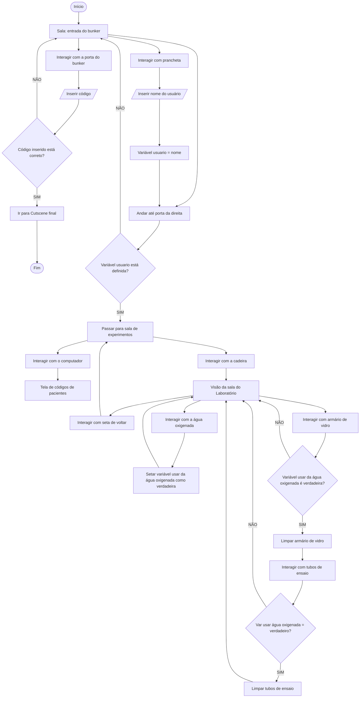

<h1 align="center">EC-Jogo</h1>

Projeto de Jogo de Experiência Criativa: Explorando Computação e Inteligência Artificial - PUCPR (2026/1)

---
# Protocolo Sanidade

> *"Você entrou em busca de segurança. O que você vai encontrar é outra coisa."*

---

## 📖 História

Anos atrás, o governo conduziu um projeto secreto para criar supersoldados por meio de uma droga experimental. Os efeitos colaterais eram devastadores: paranoia, alucinações, agressividade extrema e perda progressiva de memória. O projeto saiu do controle, resultando em mortes e colapsos mentais — e foi então abandonado. A cidade que servia de suporte ao programa seguiu em frente. Os bunkers, enterrados no subsolo, foram esquecidos.

Um dia, um erro em um sistema antigo dispara um **falso alerta de bombardeio**. A população entra em pânico e busca abrigo nos bunkers. O protagonista entra em um deles — que se fecha automaticamente e reinicia protocolos adormecidos há décadas.

Sem saber, ele é **exposto à droga experimental**.

À medida que explora o ambiente, encontra documentos, laboratórios abandonados e vestígios de experimentos fracassados. Sua percepção começa a se fragmentar, misturando **o que é real com o que não é**.

### 🔚 Finais

| Final | Descrição |
|-------|-----------|
| **Final de Dúvida** | O protagonista consegue escapar do bunker, mas as alucinações persistem. A linha entre realidade e delírio permanece turva. |
| **Final de Colapso** | O protagonista perde completamente a sanidade dentro do bunker. Não há saída — nem física, nem mental. |

---

## 🎮 Jogabilidade

**Protocolo Sanidade** é um jogo de **puzzle e terror psicológico** em 2D side-scrolling. O foco está na narrativa imersiva, na exploração cuidadosa do ambiente e na resolução de quebra-cabeças que se tornam progressivamente mais perturbadores.

### ⏱️ Mecânica Central

O jogo é dominado por um **sistema de tempo baseado na exposição à droga**:

- O jogador possui **1 minuto** antes que os efeitos se tornem irreversíveis.
- O tempo impacta diretamente a **narrativa e a dificuldade**.
- Quanto mais o tempo avança, mais intensos se tornam os **efeitos psicológicos visuais e sonoros**.

### 🔍 Desafios e Progressão

O bunker é um labirinto de segredos. Para avançar, o jogador deve:

- Encontrar e decifrar **códigos escondidos**
- Abrir **armários e portas trancadas**
- Coletar e ler **documentos e arquivos**
- Interpretar **textos codificados**
- Usar **cartões de acesso** e lidar com **falhas elétricas**

A dificuldade cresce organicamente com a exploração — o ambiente muda, os efeitos psicológicos aumentam e a fronteira entre real e imaginário se dissolve.

### 🕹️ Controles

| Tecla | Ação |
|-------|------|
| `←` | Mover para a esquerda |
| `→` | Mover para a direita |
| `E` / Clique esquerdo | Interagir com objetos |

### 👻 Inimigo

Uma **sombra paranoica** representa a deterioração mental do protagonista. Ela observa. Surge nas áreas mais escuras. **Não pode ser derrotada — apenas ignorada.**

---

## 🗺️ Fluxograma de Jogo

---

## 👥 Equipe

| Nome |
|------|
| Carolina Faria Cassaro |
| Diego Fonseca de Oliveira Bonfim Soares |
| Guilherme Ribeiro Rocha |
| Josemar Jorge Correia Filho |

---

## 🛠️ Tecnologias

- **Engine:** [Construct 3](https://www.construct.net/)
- **Estilo:** 2D Side-Scrolling
- **Produção:** Uso de IA assistiva

---

*Protocolo Sanidade — entre antes que o tempo acabe.*
